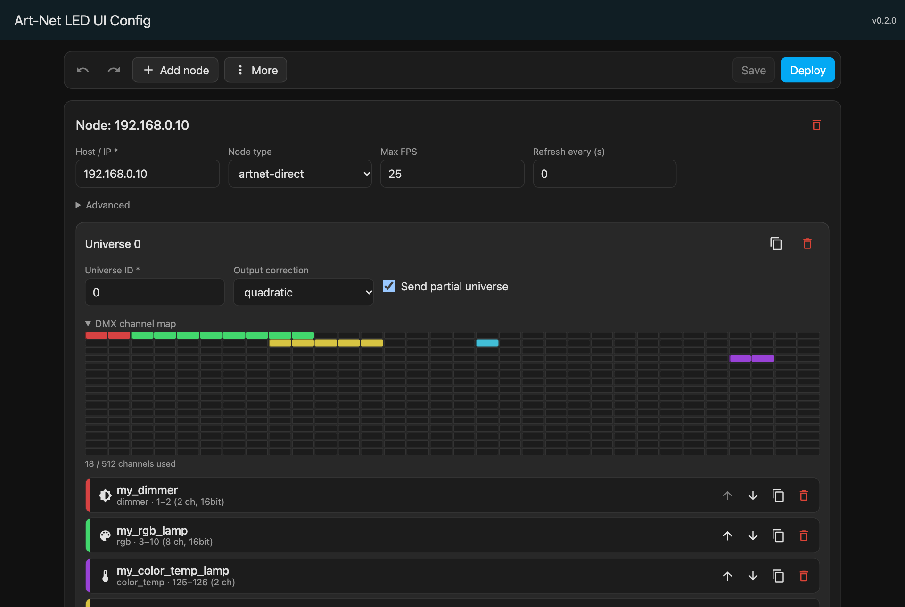
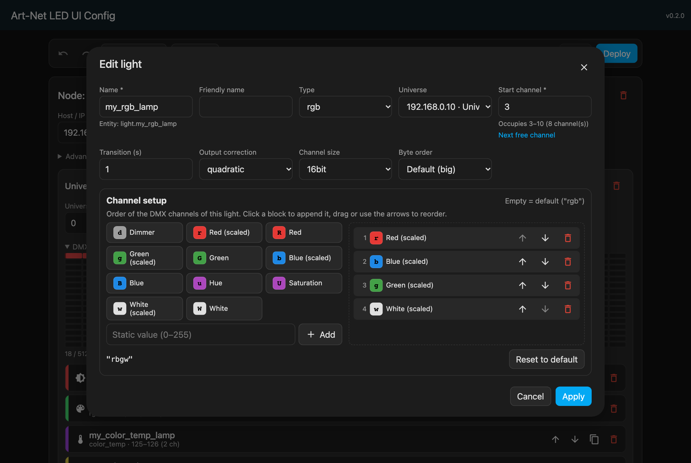
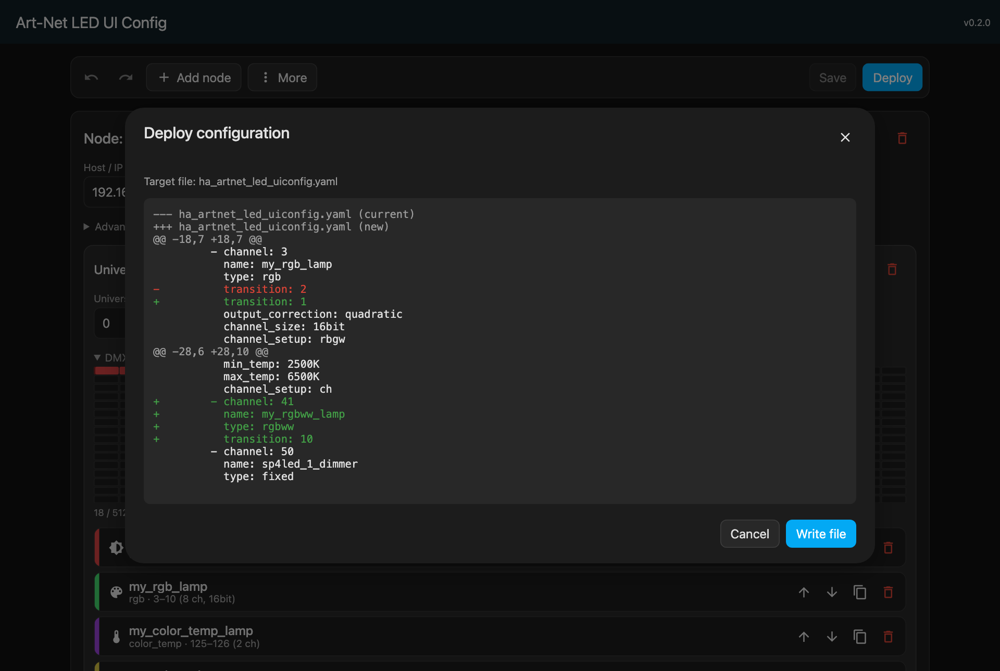
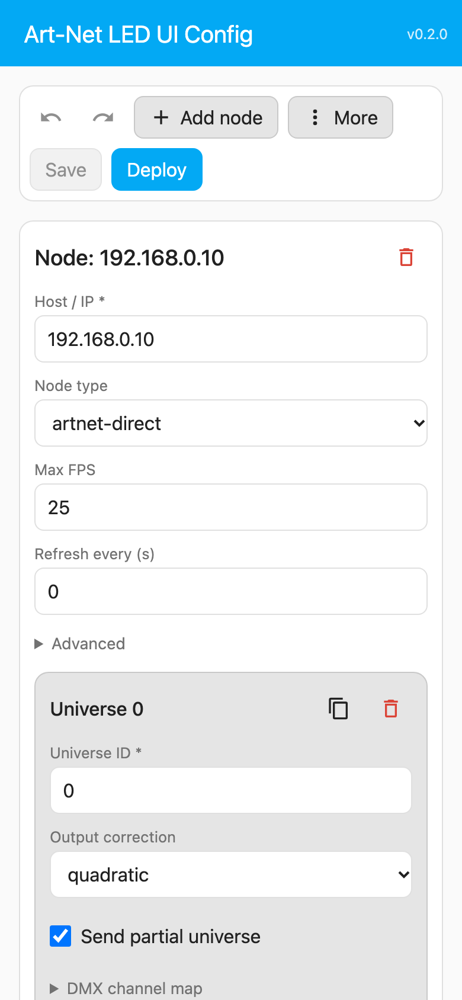
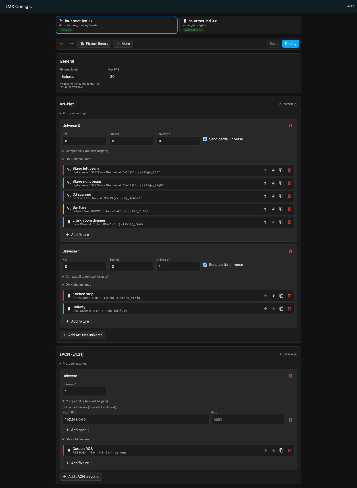
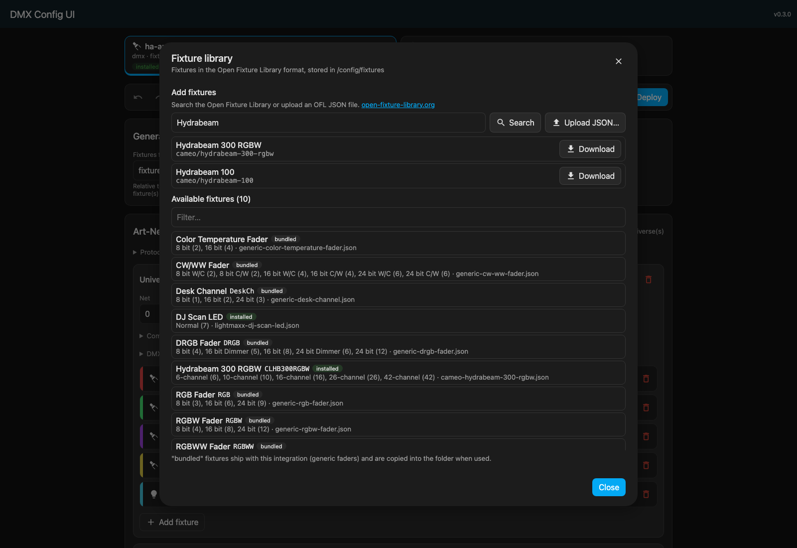
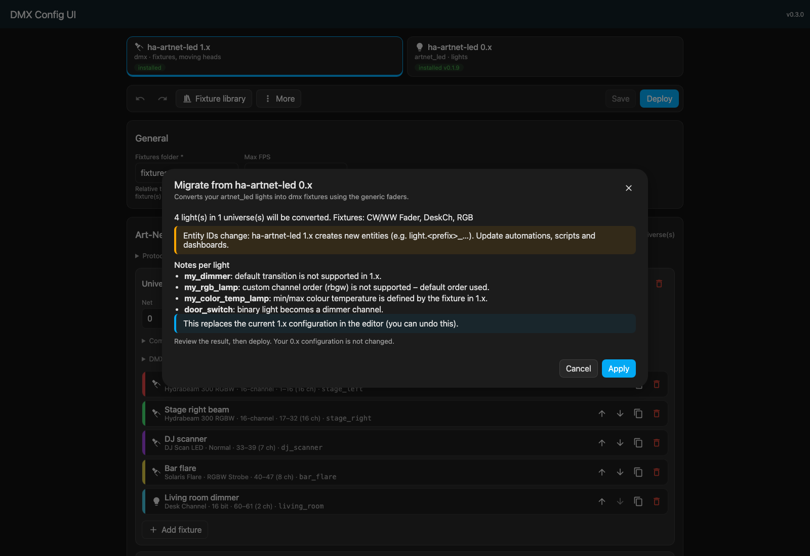

# DMX Config UI

Eine Home-Assistant-Integration, mit der du [ha-artnet-led](https://github.com/Breina/ha-artnet-led) in einem grafischen Editor statt per Hand-YAML konfigurierst. Unterstützt werden sowohl das stabile 0.x-Format `artnet_led` als auch das 1.x-Beta-Format `dmx` mit Fixtures für Moving Lights.

English: see [README.md](README.md).

## Funktionen
- Zwischen getrennten Editoren für `artnet_led` 0.x und `dmx` 1.x wechseln. Die Integration erkennt, welches Backend installiert ist.
- Art-Net- und sACN-Universes, Fixtures und Modi konfigurieren. OFL-Fixtures ermöglichen unter anderem Pan, Tilt, Gobo, Prisma und Farbe.
- Open-Fixture-Library-Dateien durchsuchen oder hochladen, mit Kanalbelegung und Vorschau der erzeugten Entitäten.
- Bestehende `artnet_led`-Fixtures mit Vorschau und Warnungen zu nicht exakt übertragbaren Einstellungen migrieren.
- Live-Validierung für doppelte IDs, Adressüberschneidungen, DMX-Kanalgrenzen und Fixture-Modi. Ein geplanter CI-Check vergleicht YAML und Kanalbreiten mit Breinas Beta-Parser.
- Der alte Editor unterstützt weiterhin `artnet_led`-Optionen wie `xy`, Byte-Order, Kanal-Setups und erweiterte Node-Optionen.
- DMX-Kanalbelegung je Universe, Funktion „Nächster freier Kanal“, Lampen und Universes duplizieren und sortieren.
- Rückgängig/Wiederholen (<kbd>Strg</kbd>+<kbd>Z</kbd> / <kbd>Strg</kbd>+<kbd>Umschalt</kbd>+<kbd>Z</kbd>), Speichern mit <kbd>Strg</kbd>+<kbd>S</kbd>, Warnung bei ungespeicherten Änderungen.
- Import aus eingefügtem YAML, aus der bestehenden `configuration.yaml` oder aus einer JSON-/YAML-Datei. Export als JSON.
- **Deploy** zeigt einen Diff, schreibt die jeweilige YAML-Datei atomar, prüft die HA-Konfiguration und legt Reparaturen für fehlende Includes oder nötige Neustarts an.
- Sprachen: Deutsch und Englisch.

## Voraussetzungen
- Home Assistant 2026.1 oder neuer
- [ha-artnet-led](https://github.com/Breina/ha-artnet-led) 0.x oder 1.x Beta installiert (eine Konfiguration kann auch vorbereitet werden, bevor das Ziel-Backend installiert ist)

## Installation (HACS Custom Repository)
1. In HACS ⋮ → **Benutzerdefinierte Repositories** öffnen.
2. `https://github.com/speedy3wk/ha-dmx-config-ui` mit der Kategorie **Integration** hinzufügen.
3. **DMX Config UI** installieren und Home Assistant neu starten.
4. Unter **Einstellungen → Geräte & Dienste → Integration hinzufügen** **DMX Config UI** hinzufügen.

Danach erscheint das Panel **DMX Config UI** in der Seitenleiste. Nur Administratoren sehen es.

## ha-artnet-led 1.x (`dmx`) bearbeiten

Wähle den Tab **DMX (1.0)**. Dort kannst du Art-Net- und/oder sACN-Universes anlegen, Geräte hinzufügen und jeweils Fixture und Modus auswählen. Die Kanalbelegung zeigt den DMX-Bereich; der Dialog gibt eine Vorschau der erzeugten `light`-, `number`- und `select`-Entitäten.

Die Fixture-Bibliothek enthält:
- Generische Fixtures aus der Open Fixture Library (MIT-Lizenz).
- Fixtures aus `/config/fixtures` oder dem konfigurierten Fixture-Ordner.
- Im Panel hochgeladene oder über die Suche aus der Open Fixture Library geladene Dateien.

Deploy schreibt `/config/ha_artnet_led_uiconfig_dmx.yaml` und fügt `dmx: !include ha_artnet_led_uiconfig_dmx.yaml` als obersten Schlüssel ein. Gibt es bereits einen `dmx:`-Block in der `configuration.yaml`, ersetzt die Reparatur diesen nach einer Sicherung unter `configuration.yaml.dmx_config_ui.bak`. Nach Deploy ist ein Neustart nötig.

Das Format `dmx` ist noch Beta und kann sich upstream ändern. Der alte Tab bleibt separat; beim Bearbeiten oder Migrieren nach `dmx` wird die alte Konfiguration nicht überschrieben.

## Migration von `artnet_led` 0.x

Öffne den Tab **DMX (1.0)** und wähle **Aus 0.x migrieren**. Der Assistent ordnet unterstützte Gerätetypen generischen OFL-Fixtures zu und zeigt vor dem Übernehmen Warnungen an. Nicht unterstützte Typen werden ausgelassen. Eigene Kanal-Setups, Übergänge, Byte-Order und Temperaturbereiche musst du gegebenenfalls manuell prüfen. Die Migration ändert zunächst nur das DMX-Dokument im Editor.

## `artnet_led` 0.x deployen
1. Konfiguration im Panel bearbeiten und **Speichern** klicken. Die Konfiguration landet im `.storage` von Home Assistant.
2. **Deploy** klicken. Du siehst einen Diff zur aktuellen Datei. Mit **Datei schreiben** bestätigen.
3. Die Integration schreibt `/config/ha_artnet_led_uiconfig.yaml`.
4. Beim ersten Mal ist die Datei noch nicht eingebunden. Das Panel zeigt die nötige Zeile an, und unter **Einstellungen → Reparaturen** kannst du sie automatisch anhängen lassen:
   ```yaml
   light artnet_uiconfig: !include ha_artnet_led_uiconfig.yaml
   ```
   Der benannte Schlüssel (`light artnet_uiconfig:`) kollidiert nicht mit einem vorhandenen `light:`-Abschnitt.
5. ha-artnet-led liest seine Konfiguration nur beim Start, daher ist ein **Neustart nötig**. Es erscheint eine Reparatur. Wenn du sie ausführst, wird die Konfiguration geprüft und Home Assistant anschließend neu gestartet.

Solange die Konfiguration Fehler enthält, ist Deploy gesperrt.

## Optionen
**Einstellungen → Geräte & Dienste → DMX Config UI → Konfigurieren**
- **Include-Datei**: Name der erzeugten Datei, relativ zu `/config`. Standard ist `ha_artnet_led_uiconfig.yaml`.

## Lovelace-Karte (optional)
Der Editor lässt sich auch als Karte einbetten.
1. **Einstellungen → Dashboards → ⋮ → Ressourcen**: `/api/ha_artnet_led_uiconfig/ha-artnet-led-uiconfig.js` als *JavaScript-Modul* hinzufügen.
2. Karte anlegen:
   ```yaml
   type: custom:ha-artnet-led-uiconfig
   ```

## Migration von 0.1.x (Add-on)
Ab Version 0.2.0 wird das Add-on bzw. die App nicht mehr benötigt. Die Integration schreibt die YAML-Datei selbst.
1. Das Add-on **Art-Net LED UI Config** deinstallieren und sein Repository aus dem Add-on-Store entfernen.
2. Die Integration über HACS aktualisieren und neu starten.
3. Die gespeicherte Konfiguration bleibt erhalten. Eine vorhandene Zeile `light: !include ha_artnet_led_uiconfig.yaml` funktioniert weiter und wird erkannt.
4. Wenn du die Konfiguration bisher von Hand gepflegt hast: im Tab **Art-Net LED (0.x)** **⋮ → Aus configuration.yaml importieren** auswählen.

## Screenshots
**Editor mit DMX-Kanalbelegung**



**Lampen-Dialog mit Kanal-Setup-Editor**



**Deploy-Vorschau mit Diff**



**Mobile Ansicht (helles Theme)**



**DMX-Fixture-Editor**



**Fixture-Bibliothek**



**Migrationsvorschau**



## Entwicklung
```bash
# Backend
python -m venv .venv && .venv/bin/pip install -r requirements_test.txt
.venv/bin/pytest tests
.venv/bin/ruff check custom_components tests scripts

# Frontend (Lit + TypeScript)
cd frontend
npm ci
npm run lint && npm test
npm run build   # schreibt nach custom_components/ha_artnet_led_uiconfig/frontend/dist/
```
Das gebaute Bundle wird mit eingecheckt; die CI prüft, ob es aktuell ist. Die Validierungsregeln gibt es für beide Targets jeweils in Python und TypeScript. Gemeinsame Testfälle liegen in `tests/fixtures/validation_cases.json` und `tests/fixtures/dmx_validation_cases.json`. Der wöchentliche Workflow prüft die DMX-Ausgabe gegen Breinas Branch `platform-refactor2`.

Version anheben (Manifest, package.json, Lockfile und pyproject):
```bash
python scripts/bump_version.py 0.3.1
```

---
Dieses Projekt ist vollständig KI-generiert.
