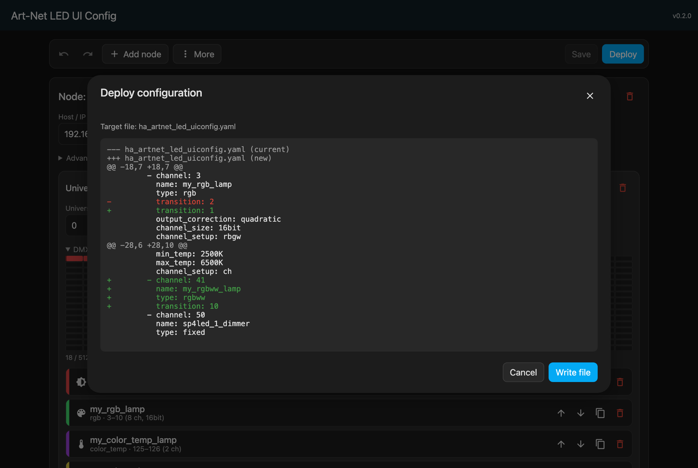
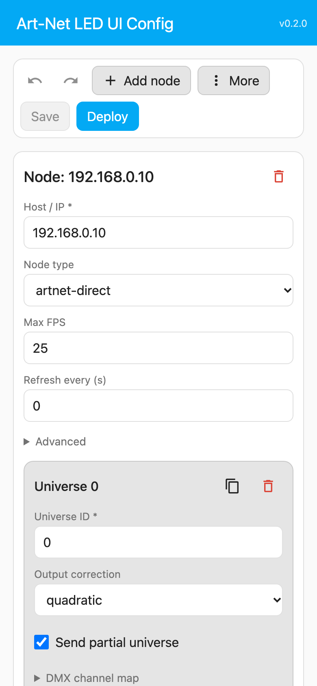
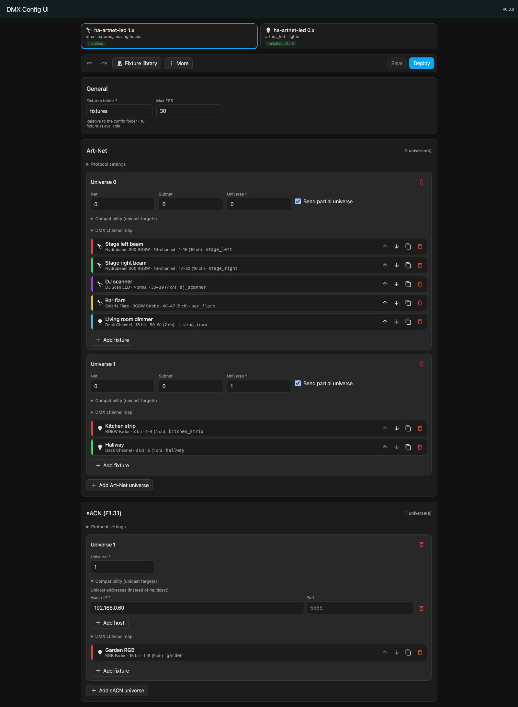
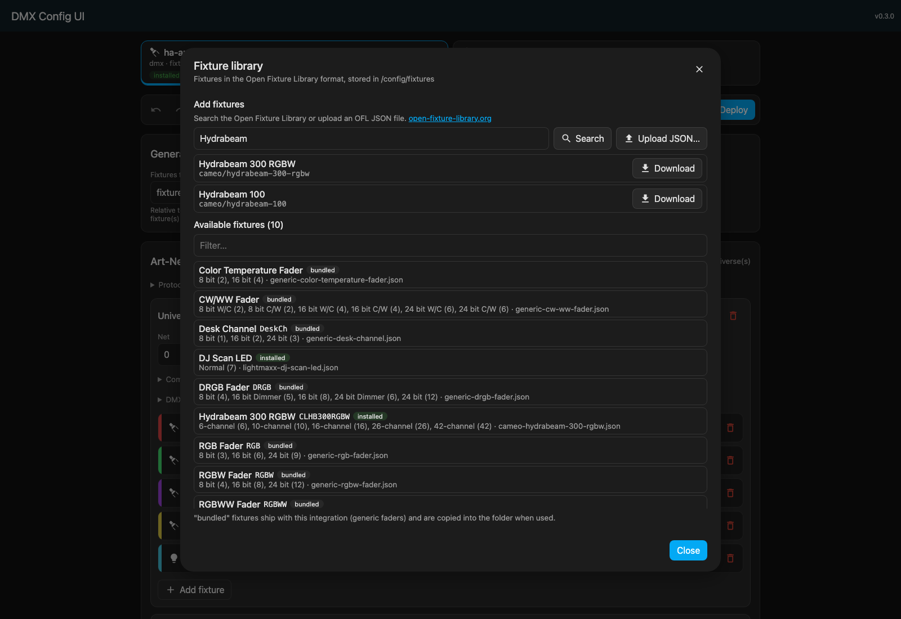

# DMX Config UI

[](https://www.home-assistant.io/integrations/marketplace/#custom-repositories)
[](https://github.com/speedy3wk/ha-dmx-config-ui/releases)
[](https://github.com/speedy3wk/ha-dmx-config-ui/actions/workflows/ci.yml)
[](https://github.com/speedy3wk/ha-dmx-config-ui/actions/workflows/validate.yml)

A Home Assistant integration that lets you configure [DMX](https://github.com/Breina/ha-artnet-led) in a visual editor instead of hand-written YAML, with fixture-based control for moving lights.

Deutsch: siehe [README.de.md](README.de.md).

## Features
- Configure Art-Net and sACN universes, fixtures and modes. OFL fixtures expose controls such as pan, tilt, gobo, prism and color.
- Browse or upload Open Fixture Library definitions, with a channel map and a preview of the entities each mode creates.
- Live validation covers duplicate IDs, address overlaps, DMX channel limits and fixture modes. A scheduled CI check also compares generated YAML and fixture channel widths with DMX's parser.
- A DMX channel map for each universe, a “next free channel” helper, duplicating lamps and universes, and reordering.
- Undo/redo (<kbd>Ctrl</kbd>+<kbd>Z</kbd> / <kbd>Ctrl</kbd>+<kbd>Shift</kbd>+<kbd>Z</kbd>), save with <kbd>Ctrl</kbd>+<kbd>S</kbd>, and a warning about unsaved changes.
- Import from your existing `configuration.yaml` or a JSON file. Export to JSON.
- **Deploy** shows a diff, writes the target YAML file atomically, checks Home Assistant's configuration and creates Repairs issues when an include or restart is needed.
- Languages: English and German.

## Requirements
- Home Assistant 2026.1 or newer
- [DMX](https://github.com/Breina/ha-artnet-led) 1.0 or newer installed (the editor can also prepare a configuration before DMX is installed)

## Installation

**Breaking change:** The integration domain changed from `ha_artnet_led_uiconfig` to `dmx_config_ui`. Existing pre-release installs must be removed and added again; saved editor settings are not migrated, while generated YAML files remain untouched.

### Marketplace (recommended, Home Assistant 2026.11+)

The [Marketplace](https://www.home-assistant.io/integrations/marketplace/) is built into Home Assistant 2026.11 and newer. DMX Config UI is installed as a custom repository.

[](https://my.home-assistant.io/redirect/marketplace_repository/?owner=speedy3wk&repository=ha-dmx-config-ui&category=integration)

1. Open **Settings → Marketplace** as an administrator and accept the community-content warning if prompted.
2. Select **Add from link**, enter `https://github.com/speedy3wk/ha-dmx-config-ui` and select **Add**. Connect GitHub if prompted. If asked for a content type, select **Integration**.
3. Open **DMX Config UI** and select **Install**.
4. Follow the integration setup flow. If it does not open, go to **Settings → Devices & services → Add integration** and add **DMX Config UI**. Restart only if the Marketplace requests it.

Integration updates still require a Home Assistant restart.

On older supported Home Assistant versions, add this repository to HACS as an **Integration**, install it and restart before adding the integration.
Existing HACS installations migrate automatically to the Marketplace when updating to Home Assistant 2026.11.

After installation, the **DMX Config UI** panel appears in the sidebar. Only administrators can see it.

## Editing DMX

Configure Art-Net and/or sACN universes, then add a device and choose a fixture and mode. The channel map shows the fixture's DMX footprint and the dialog previews the generated `light`, `number` and `select` entities.

The fixture library combines:
- Generic fixtures from the Open Fixture Library, bundled under its MIT license.
- Fixture definitions in `/config/fixtures` (or the configured fixture folder).
- Files uploaded in the panel or searched and downloaded from the Open Fixture Library.

Deploy writes `/config/dmx_config_ui_dmx.yaml` and adds the top-level include `dmx: !include dmx_config_ui_dmx.yaml`. If `configuration.yaml` already has a `dmx:` block, the Repairs action replaces it after backing up the original as `configuration.yaml.dmx_config_ui.bak`. A Home Assistant restart is required after deployment.

Deploy is blocked while the configuration has validation errors.

## Lovelace card (optional)
The editor can also be embedded as a card.
1. **Settings → Dashboards → ⋮ → Resources**: add `/api/dmx_config_ui/dmx-config-ui.js` as a *JavaScript module*.
2. Add the card:
   ```yaml
   type: custom:dmx-config-ui
   ```

## Screenshots
**Deploy preview with diff**



**Mobile layout (light theme)**



**DMX fixture editor**



**Fixture library**



## Development
```bash
# Backend
python -m venv .venv && .venv/bin/pip install -r requirements_test.txt
.venv/bin/pytest tests
.venv/bin/ruff check custom_components tests scripts

# Frontend (Lit + TypeScript)
cd frontend
npm ci
npm run lint && npm test
npm run build   # writes custom_components/dmx_config_ui/frontend/dist/
```
The built bundle is committed, and CI checks that it is up to date. The Python and TypeScript validation rules share cases from `tests/fixtures/dmx_validation_cases.json`. The weekly validation workflow checks generated output against DMX itself.

To bump the version (manifest, package.json, lock file and pyproject), run:
```bash
python scripts/bump_version.py 0.4.0
```

---
This project is fully AI-generated.
